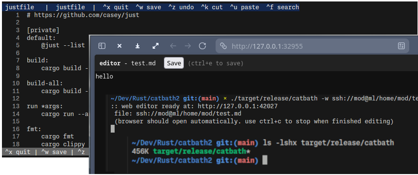

# catbath

[](https://github.com/skorotkiewicz/catbath/actions)
[](https://aur.archlinux.org/packages/catbath)
[](https://github.com/skorotkiewicz/catbath/releases)

a tiny editor: terminal-first, browser-curious, extension-friendly.
> ...for people who think F2 should format code.



## usage

```
catbath [-g|-w] [--] <file>
```

- `-g` GUI (TUI)
- `-w` Web (browser editor)
- `ssh://user@host/path/file.txt` for remote editing
- `--` allows a filename beginning with `-`

## keys

- `^Q` or `^X` quit, with a save prompt for modified files
- `^S` or `^W` save
- `^L` toggle line numbers
- `^Z` undo
- `^K` cut 
- `^U` paste
- `^F` search
- `F1`..`F12` run extensions

In the browser, use the Save button or `Ctrl+E` / `Cmd+E`. Failed saves and
extensions display an error. Browser saves and extension inputs are limited to
16 MiB. The server listens on a dynamically assigned local port.

## build

```sh
cargo build --release
# or
yay -S catbath
```

## extensions

catbath can run tiny scripts on the whole buffer with one key. For example,
press `F2` to format Rust code with `rustfmt`.

```sh
mkdir -p ~/.config/catbath/extensions
echo -e '#!/bin/sh\nrustfmt --emit stdout' > ~/.config/catbath/extensions/F2
chmod +x ~/.config/catbath/extensions/F2
```

## syntax

```sh
mkdir -p ~/.config/catbath/syntax
echo -e "keywords: def class return import if else\ncomment: #\nstring: \"" > ~/.config/catbath/syntax/py.tty
```
